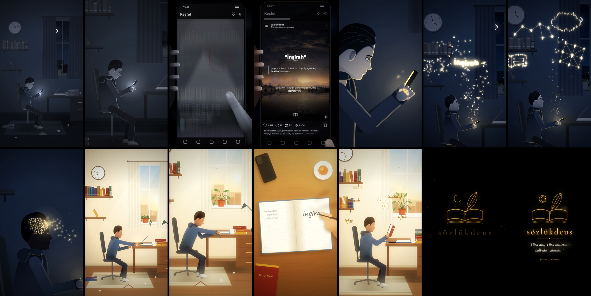

# sözlükdeus — “Türk dili, Türk milletinin kalbidir, zihnidir.”

> Bu depoda ayrıca: [`satranc/`](satranc/) — **Satranç Tahtası** (9:16, 113 sn, döngülü Reels videosu).

Instagram Reels için 9:16 dikey (1080 × 1920), 32 saniyelik 2D animasyon.
Sosyal medyada amaçsızca vakit geçiren bir genç, [@sozlukdeus](https://www.instagram.com/sozlukdeus/) sayfasının bir kelime paylaşımına rastlar;
tek bir kelimenin uyandırdığı merak, zihnindeki ve odasındaki değişimi başlatır.

**Video:** [`output/sozlukdeus_reels.mp4`](output/sozlukdeus_reels.mp4)
H.264 High, 1080×1920, 30 fps, yuv420p, AAC 48 kHz stereo, yaklaşık 30 MB, yaklaşık −12 LUFS.



Kapak karesi önerisi: [`docs/poster.jpg`](docs/poster.jpg), yani 10. saniyedeki “İnşirah” paylaşımı.

Telefondaki paylaşım sayfanın kendi gönderi şablonunu izler: koyu, sinematik bir arka plan görseli (3:4), tırnak içinde kalın yazılmış kelime, altında küçük “Sözlük” etiketi, solunda ince çizgi bulunan tanım, kelimenin kalın yazıldığı örnek cümle ve en altta açık kitap işareti. Gönderinin üst kısmında sayfanın profil görseli (siyah daire içinde beyaz açık kitap) ve `sozlukdeus` kullanıcı adı yer alır.

## Seçilen kelime

**İnşirah**: Arapça kökenli bir kelime olup “iç açılması, ferahlık” demektir.
Hikâyenin metaforuyla birebir örtüşür: zihnin açılması, içe dolan aydınlık.
Paylaşımdaki örnek cümle (“Sabahın ilk ışığı, daralmış gönlüme inşirah verdi.”) animasyon için yazılmıştır.
Arka plandaki gün doğumu görseli koddan çizilmiştir. Bu kelime için kendi görselinizi kullanmak isterseniz, onu `animation/feed.js` içindeki `paintInsirah` yerine koyabilirsiniz.
Yayından önce tanımı [sozluk.gov.tr](https://sozluk.gov.tr) üzerinden teyit etmenizi öneririm.

## Sahne akışı

| Zaman | Görüntü | Ses |
|---|---|---|
| 0–5,6 sn | Karanlık, soğuk mavi oda. Genç sandalyede çökmüş hâlde. Yüzünde yalnızca telefonun solgun ışığı var. Duvar saati hızla dönüyor, kitaplar tozlanmış, defter yarım kalmış, yerde dağınık kitaplar ve buruşuk kâğıtlar. Renkler giderek soluyor. Kamera yavaşça yaklaşıyor. | Yavaş, melankolik ve tekdüze piyano (La minör). Hızlanan saat tıkırtısı, kaydırma sesleri. |
| 5,6–8,9 sn | Telefonun ışığına dalış, ardından ekran bakış açısı. Birbirine benzeyen içerikler (“GECE 3'TE BEN: SADECE 1 VİDEO DAHA”, indirim reklamları, emojiler) gittikçe hızlanarak akıyor, bulanıklaşıp birbirine karışıyor ve griye dönüyor. | Hızlanan kaydırma sesleri. |
| 8,2–11,3 sn | sozlukdeus paylaşımı gelir ve başparmak ilk kez durur: dağların ardından doğan güneş, “İnşirah”, tanımı ve örnek cümlesi. Çevredeki içerikler kararır, kelimenin üzerinden altın bir ışık süzülür. | Piyano susar. Yumuşak bir “tok” sesi, ardından ince ve gizemli çelesta notaları. |
| 11,3–13,4 sn | Paylaşımın altın ışığı göze dönüşür. Göz bebeğinde altın yansıma belirir. Göz kapakları açılır, kaşlar kalkar; ifadesizlik meraka dönüşür. | Merakla yükselen piyano arpejleri. |
| 13,3–17 sn | Ekrandan altın harfler yükselir. “İnşirah” havada yazılır, ardından harfler birleşerek açık bir kitaba, takımyıldıza, bilgi ağına ve düşünce balonuna dönüşür. Genç doğrulup hayranlıkla yukarı bakar. | Yükselen arp ve çelesta arpejleri, açılan yaylılar, harf çanları. |
| 16,8–19,5 sn | Harfler alnından zihnine akar. Başının içindeki karanlık sinir ağı, altın çizgilerle düğüm düğüm aydınlanır ve yeni bağlantılar kurulur. | Yoğunlaşan nabız, sinaptik ışıltılar ve yükselen gerilim. |
| 19,45 sn | Zihinden dışarı bir ışık patlaması. | Derin vuruş ve büyük Do majör akor. |
| 19,5–22,5 sn | Işık başından dışa doğru yayılır. Oda griden krem ve altına döner. Pencereden sabah güneşi ve toz zerrecikleri girer, perdeler hafifçe açılır, solgun bitki canlanır, kitaplar renklenir. Genç telefonu ters çevirip masaya bırakır, defterini açar. | Umut veren, güçlü piyano ve yaylılar. Kuş sesleri, telefonun masaya bırakılışı, defter sesi. |
| 22,5–25,3 sn | Üstten çekim: el yazısıyla “inşirah — iç açılması, ferahlık ✦”. Sayfa çevrilir ve zaman atlar: sayfalar yeni kelimelerle dolmuştur (merak, tefekkür, irfan, sebat, ufuk, hezarfen). | Kalem cızırtısı, sayfa çevirme. |
| 25–28,3 sn | Genç dik oturmuş, yüzünde hafif bir tebessümle kitap okuyor. Etrafında yeni kelimeler, kâğıt sayfalar ve düşünce baloncukları süzülüyor. Oda toparlanmış, okunan kitap yığını büyümüş, saat verimli bir günü gösteriyor. Kamera yumuşakça uzaklaşıyor. | Ana tema, ardından çözülme. |
| 28,2–32 sn | Siyah ekranda altın çizgilerle açık kitap, tüy kalem ve hilal-yıldız çiziliyor. Altında **sözlükdeus**, sayfanın şiarı “*Türk dili, Türk milletinin kalbidir, zihnidir.*” ve **@sozlukdeus** yazıyor. | Do majör kapanış akoru ve çelesta. |

## Yapı

Her kare koddan çiziliyor. Hazır görsel ya da ses dosyası kullanılmadı, bu yüzden kamera geniş plandan gözün içine kadar detay kaybı olmadan gidebiliyor.

```
animation/
  index.html     önizleme oynatıcısı (oynat/duraklat, zaman çubuğu, ses)
  timeline.js    görüntü ve sesin ortak kullandığı zaman çizelgesi
  core.js        matematik, yumuşatma, renk, ışıma sprite'ları, katmanlar
  character.js   profil karakter: kafa, yüz ifadeleri, kenar ışığı, IK kol/bacaklar
  room.js        oda: pencere, gökyüzü, perdeler, bitki, raflar, saat, masa, güneş huzmeleri
  story.js       pozlar, kamera, ışık ve oda durumu (zamanın saf fonksiyonları)
  feed.js        telefon ekranı: akış, hareket bulanıklığı, sözlükdeus paylaşımı
  effects.js     harf parçacıkları, şekiller, sinir ağı, ışık patlaması, süzülen kelimeler
  insert.js      üstten defter çekimi ve el yazısı
  logo.js        kapanış kartı
  main.js        çekim geçişleri ve renk düzenleme (bloom, vinyet, film greni)
audio/compose.py   müzik ve ses efektleri sentezi (toplamsal piyano, çelesta, yaylı pad, foley, salon yankısı)
render/render.mjs  Chromium ile kare kare render ve ffmpeg ile MP4 (H.264 + AAC)
render/stills.mjs  belirli saniyelerden PNG almak için yardımcı araç
```

## Yeniden üretme

Gereksinimler: Node 22 ve Playwright (Chromium), Python 3 (`pip install -r audio/requirements.txt`), ffmpeg.

```bash
npm install                       # playwright
python3 audio/compose.py          # output/soundtrack.wav
node render/render.mjs            # render/frames/*.jpg ve output/sozlukdeus_reels.mp4
node render/render.mjs --encode-only 1   # yalnızca sesi ya da kodlamayı değiştirdiyseniz
```

Önizleme için `animation/index.html` dosyasını tarayıcıda açın. Ses için depo kökünden basit bir sunucu başlatın
(`npx http-server .`) ve `/animation/` adresine gidin.

## Instagram notları

- Logo, şiar ve kullanıcı adı ekranın orta bölümünde. Reels arayüzünün kapladığı alt %20'lik kısma önemli içerik yerleştirilmedi.
- İlk 0,7 saniye siyahtan açılıyor. Kapak olarak 10. saniyedeki paylaşım karesini seçebilirsiniz.
- Müzik tamamen bu proje için sentezlendi; telif sorunu yoktur.
