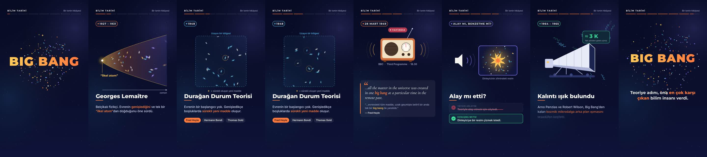

# Big Bang'in adı — seslendirme metni

Dikey 9:16 (1080 × 1920), 30 fps, 60 saniye, sessiz video: [`output/bigbang_reels.mp4`](../output/bigbang_reels.mp4)
Ekrandaki metinler seslendirmeyi destekler. Sesi aşağıdaki zaman aralıklarına göre kaydedin. Konuşma hızı rahat bir tempoda, dakikada yaklaşık 150 kelime olmalı.



| Zaman | Ekranda | Seslendirme |
|---|---|---|
| 0–6 sn | “BIG BANG” patlaması · *Bu ismi kim koydu?* | Evrenin doğuşunu anlatan teoriye “Big Bang” adını kim verdi? Cevap şaşırtıcı: teoriye hiç inanmayan bir bilim insanı. |
| 6–14,5 sn | 1927–1931 · genişleyen evren konisi, “ilkel atom” | 1920'lerin sonunda Belçikalı fizikçi Georges Lemaître, evrenin genişlediğini ve tek bir “ilkel atom”dan doğduğunu öne sürdü. |
| 14,5–24 sn | 1948 · birbirinden uzaklaşan galaksiler, araya doğan yenileri | 1948'de Fred Hoyle, Hermann Bondi ve Thomas Gold buna karşı çıktı. Onlara göre evrenin bir başlangıcı yoktu. Evren genişledikçe boşluklarda sürekli yeni madde oluşuyordu. |
| 24–36 sn | 28 Mart 1949 · radyo, “YAYINDA” · alıntı kartı | 28 Mart 1949'da Hoyle, BBC radyosunun Third Programme kanalında bir konuşma yaptı. Rakip teoriyi anlatırken, evrendeki tüm maddenin uzak geçmişte tek bir “big bang” ile, yani büyük bir patlamayla yaratıldığını söyledi. |
| 36–44,5 sn | Zihinde oluşan resim · iki kart: alay mı, benzetme mi? | Bu ifadenin teoriyle alay etmek için söylendiği sıkça anlatılır. Oysa konuşma metni, Hoyle'un dinleyicilerin zihninde bir resim canlandırmak istediğini gösteriyor. |
| 44,5–54,5 sn | 1964–1965 · boynuz anten, ≈ 3 K, 1978 Nobel madalyası | 1964'te Arno Penzias ve Robert Wilson, Big Bang'den kalan kozmik mikrodalga arka plan ışımasını tesadüfen keşfetti. Bu keşif onlara 1978 Nobel Fizik Ödülü'nü kazandırdı. |
| 54,5–60 sn | “BIG BANG” · kapanış cümlesi | Yani teoriye adını, ona en çok karşı çıkan bilim insanı verdi. |

## Doğrulanan bilgiler

- Fred Hoyle, “big bang” ifadesini 28 Mart 1949'da saat 18.30'da BBC Third Programme'da yaptığı konuşmada kullandı. Alıntı: “…all the matter in the universe was created in one big bang at a particular time in the remote past.”
- Hoyle, Bondi ve Gold ile birlikte 1948'de Durağan Durum (Steady State) teorisini savundu.
- İfadenin aşağılama amaçlı olduğu yaygın bir inanıştır. Ancak konuşma metni ve tarihçi Helge Kragh'ın (2013) incelemesi, amacın dinleyiciye zihinsel bir resim sunmak olduğunu gösteriyor.
- Penzias ve Wilson ışımayı 1964'te gözlemledi, sonuçlar 1965'te yayımlandı. 1978 Nobel Fizik Ödülü'nü paylaştılar. Ölçtükleri fazla sıcaklık yaklaşık 3,5 K idi; bugün kabul edilen değer yaklaşık 2,7 K'dir. Bu yüzden ekranda “≈ 3 K” yazıyor.

Kaynaklar: [Popular Science](https://www.popsci.com/big-bang-term-origin-fred-hoyle/), [PBS Nova: Brilliant Blunders](https://www.pbs.org/wgbh/nova/article/brilliant-blunders/), [Airminded: The first Big Bang](https://airminded.org/2021/10/03/the-first-big-bang-i/), [Nokia Bell Labs: 1978 Nobel](https://www.nokia.com/bell-labs/about/awards/1978-nobel-prize-physics/)

## Yeniden üretme

```bash
node bigbang/render.mjs                    # output/bigbang_reels.mp4
node bigbang/render.mjs --stills 12,30     # render/tmp altına seçilen saniyelerin PNG'leri
```
Önizleme için `bigbang/index.html` dosyasını tarayıcıda açın. Sahne süreleri `bigbang/timeline.js`, çizimler ve metinler ise `bigbang/scenes.js` içindedir.
