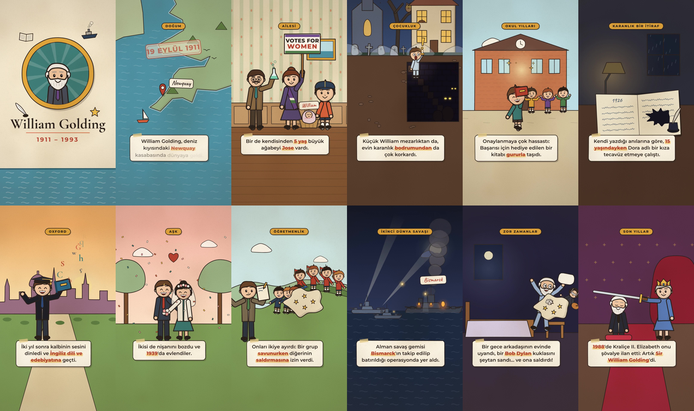

# William Golding — Bir Yazarın Hayatı

Instagram Reels için 9:16 dikey (1080 × 1920), **2 dakika 57 saniyelik** illüstrasyon tarzında biyografi animasyonu.
Seslendirme yok; anlatımı kısa, okunaklı altyazı kartları taşıyor. Filigran, kullanıcı adı ya da logo yok.

**Video:** [`output/william_golding_reels.mp4`](output/william_golding_reels.mp4)
H.264 High, 1080×1920, 30 fps, yuv420p, AAC 48 kHz stereo.



## Sahne akışı

| Zaman | Bölüm | Görüntü | Altyazı |
|---|---|---|---|
| 0:00–0:07 | Açılış | Madalyon içinde beyaz sakallı Golding portresi, el yazısıyla açılan isim | William Golding · 1911 – 1993 · Nobel ödüllü İngiliz yazar |
| 0:07–0:17 | Doğum | Britanya haritası, Cornwall'a yakınlaşma, “19 EYLÜL 1911” damgası, Newquay'e düşen iğne, kundaktaki bebek | Doğum tarihi ve Newquay |
| 0:17–0:33 | Ailesi | Elinde köpüren deney şişesiyle baba Alec, “Votes for Women” pankartlı ve süfrajet kuşaklı anne Mildred, ağabey Jose, sepetteki bebek William | Fen öğretmeni baba, oy hakkı savunucusu anne, 5 yaş büyük ağabey |
| 0:33–0:46 | Çocukluk | Gece, kilise ve mezarlık yanındaki ev; kamera yer altına iner: mumla bodruma inen William, karanlıkta parlayan gözler, çığlık ve kaçış | Mezarlık ve bodrum korkusu |
| 0:46–1:05 | Okul yılları | Okul bahçesinde yalnız William, toz bulutlu kavga ve yara bantları; ödül kitabıyla gururlu yürüyüş; sınıfta fen öğretmeninin kendi babası çıkması ve göz kırpması | Sosyal olmayan, kavgacı, onaylanmaya hassas çocuk; öğretmeni babası |
| 1:05–1:14 | Karanlık bir itiraf | Loş masa, 1926 tarihli günlük, sayfaya yayılan mürekkep lekesi. Olay canlandırılmıyor | Kendi anılarına göre 15 yaşındaki tecavüz girişimi |
| 1:14–1:27 | Oxford | Gün batımında Oxford silueti, cübbeli William elinde deney şişesiyle zoraki gülümsüyor, düşünce balonunda baba; “puf” ve şişe kitaba dönüşür, harfler uçuşur | Doğa bilimleri, ardından İngiliz dili ve edebiyatı |
| 1:27–1:41 | Aşk | Parkta Molly ile nişan yüzüğü; kimyager Ann ve nişanlısı gelir, kıvılcım ve kalpler; iki yüzük de kırılır, düğün, konfeti | Molly Evans, Ann Brookfield, 1939'da evlilik |
| 1:41–1:54 | Öğretmenlik | Uzakta Salisbury Katedrali, tarihî toprak sur; öğrenciler ikiye ayrılır, bir grup savunur, diğeri saldırır; Golding not alır | Öğrencileri gözlemlemesi |
| 1:54–2:19 | İkinci Dünya Savaşı | Savaş gemisinde selam veren er; “Er → Subay adayı → Teğmen” merdiveni ve değişen üniforma; gece Bismarck takibi, salvolar, batış; yıkık şehirde yağmur altında düşünceli Golding; bal peteği zemininde arı ve alıntı | Kraliyet Donanması, teğmenlik, Bismarck, insan doğası üzerine düşünceleri ve “İnsan, arının bal yapması gibi kötülük üretir.” |
| 2:19–2:34 | Zor zamanlar | Boş kâğıtlı daktilo, buruşuk sayfalar, dönen saat; masada çoğalan şişeler ve sallanan oda; gece misafir odası, Bob Dylan kuklasının duvardaki gölgesi şeytana dönüşür, Golding yastıkla saldırır | Yazma tıkanıklığı, alkol, kukla olayı |
| 2:34–2:47 | Son yıllar | Sahnede 1983 Nobel madalyası, alkışlayan seyirci ve konfeti; taht salonunda kılıçla şövalyelik töreni | Nobel 1983, şövalyelik 1988 |
| 2:47–2:57 | Veda | Cornwall kıyısında gün batımı, Perranarworthal'ı gösteren küçük harita; kapanışta portre, isim ve yıllar | 19 Haziran 1993, Perranarworthal, kalp yetmezliği |

## Notlardaki adlar ve yazımlar

- **Perranarworthal**: notlarda “Perra Narvortal” olarak geçen köyün doğru yazımı (Cornwall, Truro yakını).
- **Ann Brookfield**: notlardaki “Anne Brockfield”. Biyografilerde bu şekilde geçiyor.
- **Jose**: ağabeyin adı notlardaki gibi kullanıldı.
- Notlarda adı geçmeyen birkaç yer de eklendi: okul (Marlborough, babasının ders verdiği okul) yalnızca “gittiği okul” olarak geçiyor. Öğretmenlik için Salisbury, Oxford için 1930 ve “iki yıl sonra” bilgisi kullanıldı.
- “İnsan, arının bal yapması gibi kötülük üretir” Golding'in kendi sözü (“man produces evil as a bee produces honey”, *The Hot Gates*'teki “Fable” denemesi).
- İstenildiği gibi *Sineklerin Tanrısı*'na hiç değinilmedi.

## Yapı

Her kare koddan çiziliyor; hazır görsel ya da ses dosyası kullanılmadı. Çizgiler saniyede 8 kez hafifçe titriyor (“line boil”); el çizimi animasyon hissi buradan geliyor. Üstüne sabit bir kâğıt dokusu ekleniyor.

```
animation/
  index.html    önizleme oynatıcısı (oynat/duraklat, zaman çubuğu, ses)
  timeline.js   sahneler, altyazılar ve ses ipuçları (görüntü ve sesin ortak zaman çizelgesi)
  core.js       matematik, renk paleti, katmanlar, kâğıt dokusu, titreyen mürekkep çizgileri
  person.js     tek bir parametrik karakter: bebekten sakallı Nobel ödüllüsüne tüm kadro
  captions.js   bölüm etiketi, altyazı kartları (kelime kelime belirir), alıntı kartı
  scenes1.js    açılış, doğum (harita), aile, mezarlık ve bodrum
  scenes2.js    okul, itiraf, Oxford, aşk, öğretmenlik
  scenes3.js    savaş, zor zamanlar, ödüller, veda
  main.js       sahne geçişleri, kâğıt dokusu, vinyet
audio/compose.py   sahne sahne müzik ve efekt sentezi
render/render.mjs  Chromium ile kare kare render ve ffmpeg ile MP4
render/stills.mjs  belirli saniyelerden PNG almak için
```

Altyazıları değiştirmek için `animation/timeline.js` dosyasını düzenlemeniz yeterli. `*kelime*` vurgulu yazılır, zamanlar sahnenin başına göredir.

## Yeniden üretme

Gereksinimler: Node 22 ve Playwright (Chromium), Python 3 (`pip install -r ../audio/requirements.txt`), ffmpeg. Komutlar depo kökünden çalıştırılır.

```bash
python3 golding/audio/compose.py                  # golding/output/soundtrack.wav
node golding/render/render.mjs                     # kareler ve golding/output/william_golding_reels.mp4
node golding/render/render.mjs --encode-only 1     # yalnızca sesi değiştirdiyseniz
```

Önizleme için depo kökünden bir sunucu başlatın (`npx http-server .`) ve `/golding/animation/` adresine gidin.

## Instagram notları

- Altyazı kartları ekranın orta-alt bölümünde (y ≈ 1260–1500) ve sağdaki Reels düğmelerinden uzak tutuldu. Alt %20'lik kısma önemli bir şey yerleştirilmedi.
- Süre 2:57, yani Reels'in 3 dakikalık sınırının altında.
- Müzik tamamen bu proje için sentezlendi; telif sorunu yoktur.
