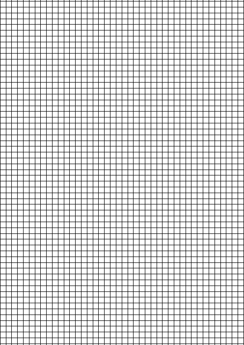

# A4 Kareli Kâğıt

Kenardan kenara tamamen karelerle dolu, yazdırmaya hazır A4 kâğıt.



| Özellik | Değer |
|---|---|
| Boyut | A4 (210 × 297 mm) |
| Kare | 5 mm × 5 mm (42 × 59 kare) |
| Çizgi | 0,25 mm, simsiyah (%100 K) |

- **Tek sayfa:** [`kareli_kagit_A4.pdf`](kareli_kagit_A4.pdf)
- **10 sayfa:** [`kareli_kagit_A4_10sayfa.pdf`](kareli_kagit_A4_10sayfa.pdf)

## Yazdırırken
- Ölçek **%100 / "Gerçek boyut"** seçilmeli ("Sayfaya sığdır" kapalı), yoksa kareler 5 mm olmaz.
- Çoğu yazıcı kenarlarda 3–5 mm boşluk bırakır; ızgara kenara kadar çizildiği için bu boşluğa kadar her yer karelerle dolu çıkar.

## Kendi ayarınla üretmek
```bash
python3 kareli_kagit.py --kare 6 --kalinlik 0.3 --sayfa 5 --cikti benim.pdf
```
`--kare` kare kenarı (mm), `--kalinlik` çizgi kalınlığı (mm). Gerekli: `pip install reportlab`.
