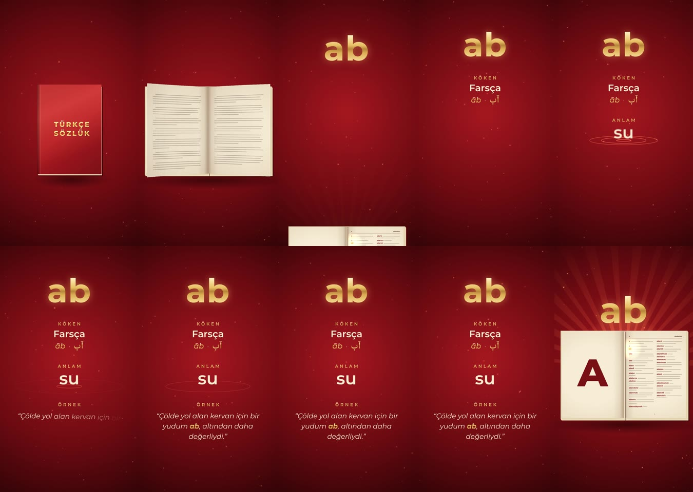

# Günün kelimesi: “ab”

Instagram Reels için 9:16 dikey (1080 × 1920), 23 saniyelik, kesintisiz dönen kelime videosu.
Yazı tipi Montserrat. Renkler sayfanın profil görselinden alındı: kırmızı zemin, altın yaldız. Logo hiçbir yere filigran olarak konmadı.
Tasarım bilinçli olarak sade tutuldu: kapakta motif yok, yazıların çevresinde süs çizgisi yok. Ekranda yalnızca kelime, köken, anlam ve örnek var.

- **Sesli:** [`output/kelime_ab.mp4`](../output/kelime_ab.mp4)
- **Sessiz** (Instagram'da kendi müziğinizi eklemek için): [`output/kelime_ab_sessiz.mp4`](../output/kelime_ab_sessiz.mp4)
- **Kapak görseli** (9:16 dikey): yalnızca kelime [`output/kelime_ab_kapak.jpg`](../output/kelime_ab_kapak.jpg), altında kökeniyle [`output/kelime_ab_kapak_koken.jpg`](../output/kelime_ab_kapak_koken.jpg)

Aynı şablonla yapılan diğer kelimeler:

| Kelime | Köken | Anlam | Video | Kapak |
|---|---|---|---|---|
| **aba** | Arapça (abā · عباء) | yünden yapılmış kalın kumaş | [`kelime_aba.mp4`](../output/kelime_aba.mp4) · [sessiz](../output/kelime_aba_sessiz.mp4) | [`kelime_aba_kapak.jpg`](../output/kelime_aba_kapak.jpg) · [kökenli](../output/kelime_aba_kapak_koken.jpg) |

“aba” için örnek cümle: “Kış gecesinde yaşlı çoban, kalın **aba**sına sarınıp ateşin başında uyudu.” TDK'de “aba” adıyla iki madde var; burada Arapça kökenli olan birinci madde kullanıldı.



## Akış

| Zaman | Görüntü | Ses |
|---|---|---|
| 0–0,9 sn | Sade, kırmızı deri kaplı bir kitap kapalı duruyor. Üzerinde yalnızca altın yaldızla **TÜRKÇE SÖZLÜK** yazıyor; yaldızın üzerinden ışık geçiyor, kenarlardan altın ışık sızıyor. | D minör yumuşak pad |
| 0,9–2,7 sn | Kapak açılıyor, sayfalar çevriliyor: iç kapak, önsöz, “A” harfi. | Kapak ve sayfa hışırtısı |
| 2,6–4 sn | Sözlük sayfasındaki **ab** maddesi parlıyor. Kelime altın ışık huzmeleriyle sayfadan yükseliyor. | Çelesta arpeji |
| 4,1–5 sn | Kitap aşağı iniyor, **ab** ekranın üstüne yerleşiyor ve üzerinden bir ışık geçiyor. | |
| 5 sn | **KÖKEN:** Farsça · *āb* · آب | |
| 8 sn | **ANLAM:** Altın bir damla düşüyor ve halkalar yayılıyor: **su** | Su damlası |
| 11–19,5 sn | **ÖRNEK:** “Çölde yol alan kervan için bir yudum **ab**, altından daha değerliydi.” Cümle kelime kelime beliriyor. Ardından bütün bilgiler yaklaşık 7 saniye boyunca ekranda kalıyor. | |
| 19,5–21,6 sn | Yazılar dağılıyor, kitap geri geliyor, **ab** sayfadaki yerine iniyor. | İnen arpej |
| 21,6–23,3 sn | Sayfalar geri çevriliyor, kapak kapanıyor. Son kare ilk kareyle aynı olduğu için video kesintisiz dönüyor. | Kapanış, başa bağlanan akor |

Ses de dairesel olarak sentezlendi: sondaki yankı videonun başına taşıyor, böylece video başa sardığında seste de bir kesinti duyulmuyor.

Kitap kapağında yalnızca “TÜRKÇE SÖZLÜK” yazıyor; Türk Dil Kurumu'nun adı ya da amblemi kullanılmadı. Sayfadaki madde başları (a, ab, aba, abacı…) gerçek sözlük sırasını izliyor, tanım satırları ise yalnızca doku olarak çizildi.
Yayından önce tanımı [sozluk.gov.tr](https://sozluk.gov.tr) üzerinden teyit etmenizi öneririm. Örnek cümle bu video için yazıldı.

## Yeni bir kelime için

1. `kelime/words/ab.js` dosyasını kopyalayın (ör. `words/inşirah.js` yerine `words/insirah.js`) ve alanları doldurun:
   `word`, `origin` (`lang`, `translit`, isteğe bağlı `native`: özgün yazılışı), `meaning`, `example` (`text`, vurgulanacak `highlight`) ve `motif`.
   `motif: "water"` damla ile halka efektini ve damla sesini açar; başka kelimelerde bu alanı silebilirsiniz (ör. `words/aba.js`).
   Tanım tek satıra rahatça sığmıyorsa iki satıra bölünür.
   Sözlük sayfası: kelime “a” bölümünün ilk sayfasındaysa (a, ab, aba, abacı…) gerçek madde başları görünür. Değilse komşu maddeler okunmayan çubuklar olarak çizilir ve sayfada yalnızca kelimenin kendisi yazılır. Sol sayfadaki büyük harf, kelimenin baş harfidir.
2. Uzun kelimeler ve tanımlar ekrana sığacak şekilde otomatik küçültülür. Örnek cümle satırlara kendiliğinden bölünür.
   Kapak görsellerinde kelime her zaman aynı puntoyla (180 px) yazılır, böylece Reels ızgarasında yan yana dizilen kapakların hepsi aynı büyüklükte görünür. Tek satıra sığmayan bir kelime küçültülmez; Türkçe hece kurallarına göre iki satıra bölünür (ör. “abdest-sizlik”, “muvaffa-kiyetsizlik”). Birden çok kelimeden oluşan maddeler boşluktan ya da tireden bölünür.
3. Üretim:

```bash
python3 kelime/audio.py insirah         # kelime/out/soundtrack_insirah.wav
node kelime/render.mjs --word insirah    # output/kelime_insirah.mp4 ve _sessiz.mp4
node kelime/cover.mjs --word insirah     # output/kelime_insirah_kapak.jpg ve _kapak_koken.jpg
```

Önizleme için `kelime/index.html?word=ab` dosyasını tarayıcıda açın. `node kelime/stills.mjs <klasör> --word ab 3.3 9 14` komutu seçtiğiniz saniyelerden PNG kareler alır.

Gereksinimler: Node 22 ve Playwright (Chromium), Python 3 ile numpy, ffmpeg.

## Dosyalar

```
kelime/
  index.html     önizleme oynatıcısı (render modunda yalnızca tuval)
  timeline.js    görüntü ve sesin ortak kullandığı zaman çizelgesi
  anim.js        sahne: kitap (perspektifli sayfa çevirme), ışık, toz, yazılar
  words/ab.js    kelimenin içeriği
  audio.py       döngüye uygun müzik ve efekt sentezi
  render.mjs     kare kare render ve ffmpeg ile MP4 (H.264 + AAC)
  stills.mjs     tek tek kare almak için yardımcı
  cover.mjs      kapak görselleri (yalnızca kelime; kelime ve kökeni)
  fonts/         Montserrat ve Noto Naskh Arabic (SIL OFL), yerel kopya
```

## Instagram notları

- Önemli içerik ekranın üstteki 220 ve alttaki 400 pikselinin dışında kalıyor, böylece Reels arayüzünün altında kalmıyor.
- Kapak olarak `output/kelime_ab_kapak.jpg` (yalnızca kelime) ya da `output/kelime_ab_kapak_koken.jpg` (kelime ve kökeni) dosyasını kullanabilirsiniz. Yazı ekranın tam ortasında olduğu için profil ızgarasındaki 3:4 kırpmada da tamamen görünür. Videodan bir kare seçmek isterseniz 17. saniyede bütün bilgiler bir arada ([`poster.jpg`](poster.jpg)).
