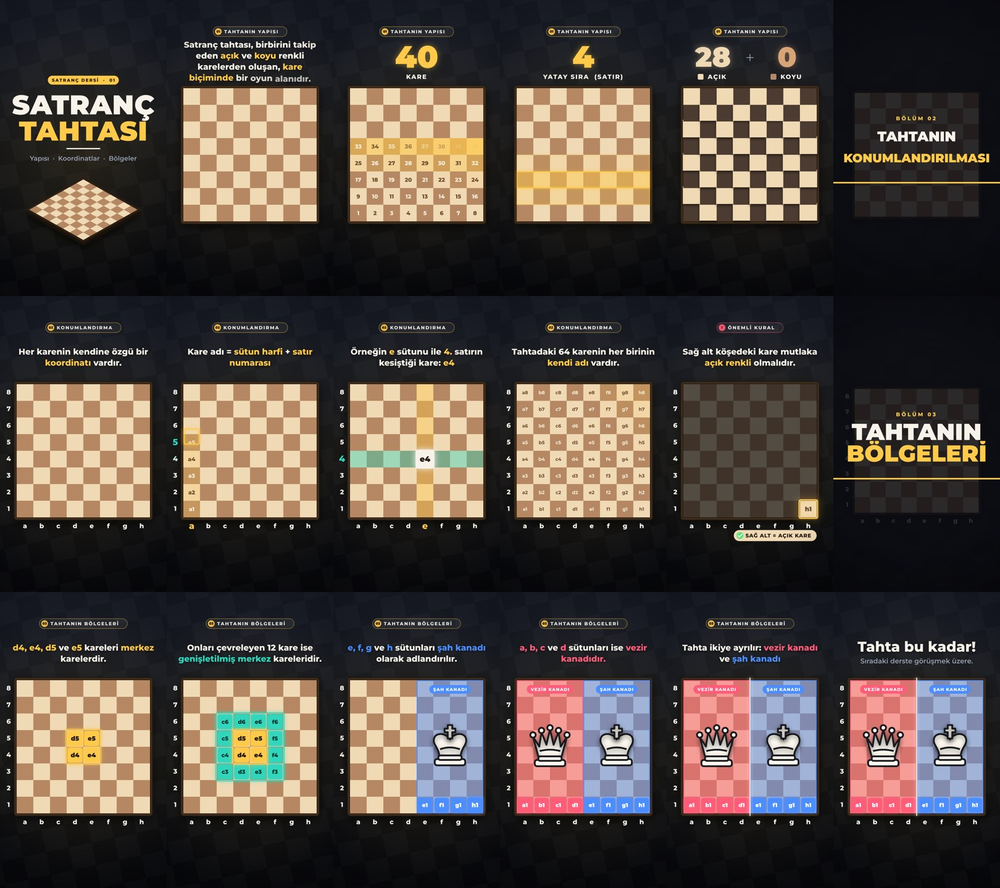

# Satranç Dersi 01 — Satranç Tahtası

Instagram Reels / TikTok / Shorts için 9:16 dikey (1080 × 1920), 75 saniyelik, **döngülü (loop)** eğitim videosu.
Tüm yazılar **Montserrat** ile, tüm ses efektleri koddan sentezlendi (telif sorunu yok).

**Video:** [`output/satranc_tahtasi.mp4`](output/satranc_tahtasi.mp4)
H.264 High, 1080×1920, 30 fps, yuv420p, AAC 48 kHz stereo.



## Akış

| Zaman | Bölüm | Görüntü | Ses |
|---|---|---|---|
| 0–3 sn | Kapak | **SATRANÇ TAHTASI** başlığı, “Satranç Dersi · 01” etiketi, izometrik tahta | Başlık vuruşu, ışıltı |
| 3–9 sn | 01 · Tahtanın yapısı | Tahta kare kare çapraz dalga hâlinde kurulur. “Birbirini takip eden açık ve koyu renkli karelerden oluşan, kare biçiminde bir oyun alanı” | Ahşap “tok” sesleri |
| 9–12 sn | | 1’den 64’e sayaç, kareler tek tek numaralanır: **64 KARE** | Yükselen tıkırtılar, ding |
| 12–15 sn | | 8 yatay sıra (satır) alttan üste parlar | Swish + nota |
| 15–18 sn | | 8 dikey sütun soldan sağa parlar | Swish + nota |
| 18–21 sn | | Önce 32 açık, sonra 32 koyu kare öne çıkar: **32 + 32** | Pop sesleri |
| 21–24 sn | Ara başlık | **TAHTANIN KONUMLANDIRILMASI** (büyük font, gelir ve gider) | Whoosh + vuruş |
| 24–28 sn | 02 · Konumlandırma | “Her karenin kendine özgü bir koordinatı vardır.” a–h harfleri ve 1–8 sayıları yerleşir | Tıklar |
| 28–32 sn | | Sütunlar harflerle (a–h), satırlar sayılarla (1–8) | Süpürme |
| 32–36 sn | | a1 → a2 → … → a8 yürüyüşü | Yükselen tok sesleri |
| 36–40 sn | | e sütunu × 4. satır = **e4** | Swish, ding |
| 40–42 sn | | Tüm 64 karenin adı dalga hâlinde görünür | Işıltı |
| 42–48 sn | ! · Önemli kural | “Sağ alt köşedeki kare mutlaka açık renkli olmalıdır.” Tahta kararır, **h1** parlar, “SAĞ ALT = AÇIK KARE ✓” | Uyarı, onay sesi |
| 48–51 sn | Ara başlık | **TAHTANIN BÖLGELERİ** | Whoosh + vuruş |
| 51–56 sn | 03 · Bölgeler | Merkez kareler: **d4, e4, d5, e5** (altın) | Pop, ding |
| 56–62 sn | | Genişletilmiş merkez: c6, c5, c4, c3, d3, e3, f3, f4, f5, f6, e6, d6 (turkuaz) | Pop dizisi |
| 62–66 sn | | **Şah kanadı**: e, f, g, h sütunları (mavi), şah figürü, e1 f1 g1 h1 | Süpürme, akor |
| 66–71 sn | | **Vezir kanadı**: a, b, c, d sütunları (kırmızı), vezir figürü, a1 b1 c1 d1, ortadan ayıran çizgi | Süpürme, akor |
| 71–73 sn | Kapanış | “Tahta bu kadar! Sıradaki derste görüşmek üzere.” | Onay sesi |
| 73–75 sn | Döngü | Tahta dağılır, kapak başlığı geri gelir. Son kare = ilk kare | Whoosh → (başa dönünce) başlık vuruşu |

Döngü kusursuzdur: kapak başlığı tam 75. saniyede yerine oturur ve video 0. saniyedeki kareyle devam eder.
Arka plan deseni ve fon sesi tam olarak video süresiyle periyodiktir; ses efektlerinin ve yankının kuyrukları başa sarılır, bu yüzden geçişte çıt ya da boşluk duyulmaz.

## Not: koordinatlar

Satranç notasyonunda **sütunlar (dikey) a–h harfleriyle**, **satırlar (yatay) 1–8 sayılarıyla** adlandırılır; kare adı “sütun harfi + satır numarası” şeklinde okunur (a1, e4, h8…).
Videoda bu standart kullanıldı.

## Yapı

```
anim/
  index.html     önizleme oynatıcısı (oynat/duraklat, zaman çubuğu, ses, döngü)
  timeline.js    fps ve süre
  scene.js       tüm sahneler (zamanın saf fonksiyonu) + ses efekti işaretleri (buildCues)
  fonts/         Montserrat (latin + latin-ext, Türkçe karakterler)
audio/compose.py   ses efektleri ve fon sentezi (yalnızca numpy), döngüye uygun dairesel miks
render/render.mjs  işaretleri dışa aktarır, kareleri Chromium ile çizer, sesi üretir, ffmpeg ile MP4
render/stills.mjs  belirli saniyelerden PNG almak için
```

## Yeniden üretme

Gereksinimler: Node 22 + Playwright (Chromium), Python 3 + numpy, ffmpeg.

```bash
cd satranc
node render/render.mjs                  # kareler + ses + output/satranc_tahtasi.mp4
node render/render.mjs --encode-only 1  # yalnızca ses/kodlama değiştiyse
node render/stills.mjs 10 37.5 46       # tek tek kare önizlemesi
```

Önizleme: depo kökünden `npx http-server .` çalıştırıp `/satranc/anim/` adresini açın.

## Seslendirme eklemek isterseniz

Ekrandaki metinler seslendirme metni olarak kullanılabilir; zamanlamalar yukarıdaki tabloda.
Kendi sesinizi ekledikten sonra efektleri biraz kısmak için `audio/compose.py` içindeki `GAIN` değerlerini düşürebilirsiniz.
